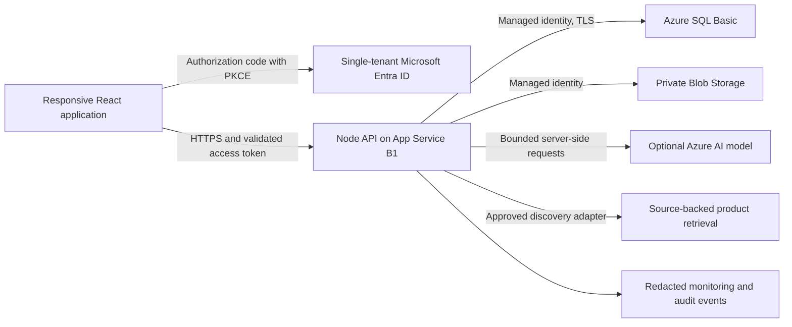

# EtalonOps MRF Builder — proposal A

Status: architecture/security direction and the local frontend milestone approved in chat. Paid Azure provisioning and DNS remain unapproved. Prepared October 17, 2026.

**Current update:** [verified pricing](COST_UPDATE.md) supersedes the original unverified allowances below. [SQL Server validation](SQL_SERVER_MILESTONE.md) records the now-tested local Microsoft database adapter; actual Azure/Entra deployment remains pending.

This document records the original architecture proposal. The local frontend has since been implemented; see VISUAL_REVIEW.md for current evidence. No application has been deployed to Azure, no billable resources have been provisioned, and no DNS has been changed. Backend and cloud capabilities below remain proposed.

## Evidence and scope

The supplied `CODEX_KICKOFF_V2.md` and all three 1448×1086 PNGs were read/viewed. They replace earlier designs. The requested GitHub checkout is empty and has an unborn `work` branch; there is no existing application to preserve or migrate. Node 24, npm 11 and Python 3.12 are available. The Azure CLI and a connected Azure management tool are not available. An Azure-related federation-variable name is present, but this does not establish authorization to the owner's Azure tenant or subscription; no credential contents were inspected.

**Reference discrepancy:** `01_database_results.png`, `02_ai_clarification.png`, and `03_ai_suggestions.png` all depict the no-match/clarification conversation and an empty MRF list, with small layout variations. None depicts a verified-results table, AI candidate-results table, or populated delivery-override row. Preserve their shared visual language and implement those additional states from the written V2 requirements; confirm them in the visual-preview milestone. Replacement screenshots are welcome but do not block that work.

Only this standalone POC is in scope. Existing EtalonOps applications, Power Automate flows, production databases, purchasing workflows, submission/approval, email and PDF generation remain outside this project.

## Recommended architecture

Use one TypeScript application with a React/Vite frontend and a Node.js API, deployed together to **Azure App Service, Linux Basic B1, East US**. Prefer the supported Node 24 LTS runtime, subject to verification of the App Service runtime list before deployment. Use Azure SQL Database **Basic, 5 DTU, 2 GB**, a private Azure Blob Storage container on **StorageV2 Standard LRS**, and Microsoft Entra ID single-tenant authentication. Use a managed identity for database and storage access. Keep application search in SQL and application code rather than adding Azure AI Search or a vector database for a 150–250-item catalog.

Serving frontend and API from the same origin reduces deployment pieces and cross-origin configuration. The static shell may load without authentication; all project, draft, catalog-administration and discovery APIs require authorization. A public shell must contain no customer records or credentials.

Use deterministic normalization, aliases, exact matches and weighted token/fuzzy matching first. At this catalog size, a filtered candidate set plus application ranking is sufficient. Store scores and reasons; do not convert a low-confidence candidate into a verified mapping. SQL full-text or a dedicated search service can be considered only after measured need.

### Alternatives

| Option | Benefit | Tradeoff / decision |
| --- | --- | --- |
| Static Web Apps + Functions + SQL + Blob | Static hosting and consumption API can reduce idle compute | Tenant-specific custom authentication, API integration limits and plan requirements must be verified; more auth/deployment boundaries. Do not assume the default Microsoft provider is tenant-restricted. Not selected for the first POC. |
| Container Apps Consumption + SQL + Blob | Scale-to-zero API may have low idle cost | Container registry, cold starts and more operational setup. Revisit if compute spend dominates. |
| App Service B1 + SQL Basic + Blob | One web deployment, predictable small baseline, conventional authentication | Always-on cost and a single modest instance; acceptable for a small exploratory POC, not a high-availability commitment. Recommended. |
| Free App Service / local-only | No hosting charge for visual evaluation | Free shared hosting is unsuitable as the security/availability baseline for real project data. Use local-only development for milestone B. |

## Price proposal and spending controls

**These are USD planning allowances, not verified current Azure quotes.** Attempts to fetch official pricing and authentication documentation were rejected by the execution environment's egress proxy with HTTP 403. No substitution of old rates as current rates has been made. Subscription currency, discounts, region availability and model entitlement have not been inspected. No paid SKU is approved by this proposal alone.

All proposed Azure resources are East US, with no cross-region application deployment. Model availability, regional processing behavior and SKU support must be checked before enabling AI. Never silently switch to Global processing or another region. Region selection is a POC default, not evidence of an approved data-residency policy; sensitive/customer data is excluded until requirements are established.

Assume 730 hosting hours/month, one B1 Linux instance, one SQL Basic database within 2 GB, 1 GB of images, fewer than 10,000 storage transactions, less than 1 GB external transfer, and 10 testers. Light use means roughly 1,000 material searches and at most 200 discovery sessions/month, each with no more than two model turns and one paid retrieval transaction. Search against the verified catalog consumes no model calls.

| Resource / proposed SKU | Idle monthly allowance | Light-use monthly allowance | Notes |
| --- | ---: | ---: | --- |
| App Service Linux Basic B1, East US | $13–20 | $13–20 | One always-on instance; no separate paid deployment slot assumed. |
| Azure SQL Basic, 5 DTU / 2 GB, East US | $5–8 | $5–8 | Confirm included backup storage/retention and storage capacity before creation. |
| StorageV2 Standard LRS, Hot, East US | $0–1 | $0–2 | Private image container; transactions, transfer and versions count. |
| Application Insights / Log Analytics, pay-as-you-go, East US | $0–2 | $0–3 | Redacted, sampled telemetry with a proposed 0.1 GB/day ingestion cap; confirm supported configuration. |
| Entra ID, existing tenant / individual app assignments | $0 incremental assumed | $0 incremental assumed | No premium features, group assignment or new licenses assumed. Tenant licensing/policy still requires verification. |
| Azure AI model, proposed GPT-4.1-mini Standard regional deployment | $0 if no calls | $1–5 allowance | Deployment type, model version, East US availability and current token rates unverified. No provisioned throughput. Remains disabled until separately confirmed. |
| Paid sourced retrieval, proposed Grounding with Bing Search | $0 if no calls | $0–10 allowance | Unverified service eligibility, billing unit and current rate. 200 transactions would cost $7 at an illustrative $35/1,000, **not a claimed current rate**. Agent/grounding dependencies may add charges. Do not deploy this integration until the complete current service chain is quoted. |
| **Planning total** | **$18–31** | **$19–48** | Excludes tax, support plans, domain registration, premium identity licenses and unforeseen usage. |

Propose a **$50/month operating target**, with subscription/resource-group budget alerts at $25, $40 and $50, and forecast alerts. Azure budgets alert; **they do not stop billing**. The target is not a provider-enforced cap. If a strict zero-overrun guarantee is required, keep paid hosting and discovery disabled.

Enforce application limits before every model/retrieval call: initially 20 discovery sessions/user/day, 200 total sessions/month, at most 2 model calls/session and 1 paid retrieval transaction/session, bounded prompt/output sizes, one active session/user, request timeout, no unbounded tool loops, and a global feature kill switch. Atomically reserve quota in the database across instances; count failures and provider-billable retries. Permit a user to continue clarification/fallback after the automated-call budget is exhausted. No automatic paid retry. Preserve drafts on errors. Lower limits after the actual rate card is confirmed to fit the agreed allowance. Limits contain AI spend; they do not cap all Azure charges.

Before any paid action: verify prices from the Azure Retail Prices API/pricing calculator and model/grounding rate cards, inspect subscription region and quotas, itemize the final service chain, and obtain explicit owner approval for that concrete scope. If current prices differ from these allowances, revise the proposal first. Read-only access to `prices.azure.com`, `azure.microsoft.com`, and `learn.microsoft.com` is needed for this verification; no DNS or resource change is needed.

Official verification targets:

- https://prices.azure.com/api/retail/prices
- https://azure.microsoft.com/en-us/pricing/details/app-service/linux/
- https://azure.microsoft.com/en-us/pricing/details/azure-sql-database/single/
- https://azure.microsoft.com/en-us/pricing/details/storage/blobs/
- https://azure.microsoft.com/en-us/pricing/details/monitor/
- https://azure.microsoft.com/en-us/pricing/details/cognitive-services/openai-service/
- https://azure.microsoft.com/en-us/pricing/details/grounding-with-bing-search/
- https://learn.microsoft.com/en-us/entra/identity-platform/single-and-multi-tenant-apps

## Authentication and authorization

- Register a **single-tenant** Entra application; use the explicit tenant authority, not `common` or `organizations`. Browser login uses authorization code + PKCE and no browser client secret. Request an API-specific scope. Validate API token signature using trusted tenant keys, issuer, audience, tenant ID, expiry, not-before and required scope on every protected request. An ID token is not an API access token.
- Require enterprise-application assignment and assign named test users individually. Define `Foreman` and `Admin` application roles. Deny access without the required role. An Admin may use foreman features, but administration must never follow from a self-selected frontend role. Tenant policy may require an authorized administrator for registration/consent; do not request directory-wide permissions by default.
- Identify owners by `(tenant_id, object_id)`, never email or client-supplied owner IDs. Authorize project membership plus ownership on draft read/write/list/export and nested line operations. Return no other user's draft content. A foreign guessed UUID must fail. Administrative import/image routes require Admin even if called directly.
- Store browser access tokens in memory using the supported MSAL flow; do not save them beside drafts in localStorage. Render untrusted content as text. Set a strict Content Security Policy, HTTPS-only, HSTS, anti-framing and MIME headers. Limit request sizes and validate all payloads. No wildcard CORS. Never log authorization headers, model secrets or whole draft/conversation bodies.
- Give the App Service managed identity only application database permissions and access to the image container. Use a separate migration identity for DDL; normal application traffic cannot change schema. Prefer Entra-only SQL authentication, encrypted connections and explicit SQL firewall allowance for necessary App Service outbound IPs. Do not enable the broad “Allow Azure services” rule. A public, firewalled database endpoint is a POC tradeoff; private networking is a separate cost/security decision.
- Use short-lived GitHub-to-Azure OIDC federation for deployments after secure authorization. Scope deployment access to this POC's resource group; avoid subscription Owner or tenant-wide directory privileges. Initial identity/RBAC grants may require an existing authorized administrator. Managed identity handles SQL/Blob and model access where supported; if retrieval requires a credential, use a secure provider workflow and Key Vault reference, never chat or the repository. Quote any added Key Vault/service costs first.

## Schema and import contract

Implement versioned SQL migrations and a repository layer with ownership predicates. Use UUIDs, UTC timestamps, optimistic concurrency (`rowversion`/ETag), decimal quantities (not binary floating point), and `date` for requested delivery dates. Default dates must not shift with time zone conversion.

| Entity | Important fields / rules |
| --- | --- |
| Project / membership | Tenant ID, project ID, display name; membership principal and role. No invented production project/foreman identities. |
| Material | Stable ID, description, manufacturer/part number only when known, specifications, product/package UOM, active status and verification provenance. |
| Translation / alias | Normalized phrase, material ID, requested UOM/context, alias type, verification state, reviewer/time, source/import batch. Only controlled approved imports create verified records in this POC. |
| Unit / conversion basis | Canonical unit, dimension, explicit pack/length basis and provenance. `EA`, `FT`, `STICK`, `BOX` remain distinct. No universal stick-to-feet conversion. |
| Draft | Project, owner tenant/object IDs, default delivery date, status, version, created/updated time. Owner cannot be changed by a save payload. |
| Draft line | Draft, ordering, raw quantity/text, parsed/confirmed requested UOM, resolved material or candidate snapshot, source flag (`verified`, `ai_provisional`, `user_description`), normalized quantity/UOM only when defensible, conversion basis, delivery mode (`inherit` or `override`), nullable override date, version. Check constraint requires a date only for overrides. |
| Discovery session / candidate | Owner, draft/input context, bounded messages, candidate snapshots, source URLs, retrieval time, source facts and unverified status. Retention and access rules apply. Never write a verified translation as a discovery side effect. |
| Image asset / association | Blob ID, content hash, MIME/size/dimensions, source URL, rights basis, product ID, approval state, reviewer/time. Reject associations by product + image hash/source so they cannot reappear as verified through rediscovery. Translation approval does not approve an image. |
| Import batch / audit / quota | File hash, schema version, preview/conflicts, admin decision, inserted IDs, before-images where permitted; actor/action/target/time; atomic quota reservations. Audit content excludes secrets and unnecessary conversation text. |

**Delivery inheritance:** calculate effective date from draft default whenever line mode is `inherit`; do not copy the default into every line. An override survives default changes. “Use MRF Date” resets mode and clears the override.

**Units:** `1000` + `1 inch PVC` is insufficient to determine feet or sticks. Ask for a unit; preserve the raw values while unresolved. A candidate's package unit must not silently replace the requested unit. Save unresolved lines as drafts with a clear status; never display a fabricated normalized quantity.

**CSV v1:** UTF-8 with a header and documented quoting. Proposed columns: `schema_version, external_key, description, aliases_json, requested_uom, product_uom, manufacturer, manufacturer_part_number, specifications_json, conversion_basis_json, source_url, verification_basis`. Image review is a separate import/link workflow. Use stable external keys plus batch/file hashes for idempotency; do not rely only on a description. An administrator reviews a dry-run report before an explicit transactional apply. Report malformed rows, unknown units, duplicate keys, ambiguous aliases, conflicting product details and attempted overwrite of reviewed data. Reapplying the same approved batch is a no-op. Export with formula-injection protection for spreadsheets and a documented reversible escaping convention.

Rollback a batch by its recorded changes, with version checks. If records have later edits or are referenced, refuse destructive rollback and report conflicts; deactivate/correct catalog records without erasing historical line snapshots. Build migration/schema/import tests before preparing the 150–250-item candidate dataset. Fixtures are clearly synthetic, not a verified catalog. Only reviewed, source-supported admin approval promotes seed records. No automatic expansion from searches or AI chats.

## Visual implementation and mobile acceptance

Use semantic React components and CSS Grid/Flexbox: application shell, project selector, slim header, item-entry form, verified matches, clarification choices/conversation, provisional candidate results, and editable MRF lines. Keep the orange brand mark, approximately 196 px desktop light navigation, pale workspace, white panels, restrained blue actions, dark headings, subdued secondary text and thin neutral borders. Use an approximately 68 px desktop top bar as a starting reference, not a fixed device constraint. System UI sans-serif avoids a new paid-font dependency.

Use 2–4 px control radii, compact 8–12 px panel gaps, restrained padding, readable 14–16 px primary text and no large shadows. The screenshot's red-tinted miss banner becomes a compact neutral status with a small warning indicator in accordance with the written refinement against large colored callouts. No supplier choice or Request Summary sidebar. A row's `+ Add` adds that exact row; candidate radio selection is unnecessary. Disable duplicate clicks while an add is being applied, without prohibiting intentional subsequent material lines.

At phone widths, collapse navigation into a keyboard-accessible menu, wrap the project heading, keep foreman/date/save near the top, stack quantity and description, and make Find Matches prominent. Convert results and MRF rows into labeled cards; no horizontal scrolling to reach Add or delivery controls. Keep practical 44 px touch targets, visible focus, labeled fields, live result/save announcements and a keyboard-friendly conversation composer. Other / none of these immediately exposes actual free-text entry. The original-description fallback remains available if discovery is unavailable or exhausted. Use appropriately labeled missing-image placeholders; do not crop screenshot photos into a catalog.

Automated Playwright flows must exercise 320, 375, 390, 768 and 1440 px widths, portrait/landscape representatives, long descriptions, keyboard navigation and default/override/reset dates. Capture all three functional states plus populated MRF cards at desktop and phone sizes. Check true 200% browser zoom manually or with supported browser automation; do not describe a narrower viewport or CSS zoom alone as equivalent proof. Verify no primary content overflow and test composing messages with mobile keyboards where device testing is available. Label mocked data and local draft storage clearly; local mock identity switching is not proof of secure authorization.

The frontend milestone includes interactive fixture-based results, row addition/edit/removal, conversational mock replies and local draft save/resume. No real product claims or signed-in production identity are implied. Owner visual approval is required before substantial backend coupling.

## Discovery and image security

Both an actual database miss and “None of these is what I want” enter the same context-preserving clarification flow. Offer short options and free text; preserve normal conversation and ask only material/unit questions needed to proceed. AI may interpret wording and propose source-backed candidates, but cannot invent part numbers or approve catalog data. Product facts must be tied to retrieved source excerpts/URLs and timestamps. Show unknown fields honestly. “Use My Description” saves user wording, quantity and source flag only.

Keep model and retrieval integrations behind adapters and feature flags. Do not assume a model alone performs live product search. Verify that the selected retrieval service returns enough source information for product-level evidence, citations, lawful thumbnails and the required UX before enabling it. If grounding is unavailable or licensing is unsuitable, keep discovery explicitly unavailable with manual-description fallback; this is a limitation, not completion of the live discovery milestone. No arbitrary scraping, purchased catalog or external data service without review of terms and cost.

Treat user messages, supplier pages and product metadata as untrusted data. The model cannot issue SQL, grant roles, choose arbitrary tools or write verified mappings. Use structured-output validation and server-owned tool arguments. Retrieval/image fetches use approved HTTPS hosts, DNS/IP checks, redirect validation, time/byte limits and deny private/link-local/metadata endpoints to prevent SSRF. Re-encode permitted image types, remove metadata, reject SVG/active content, validate magic bytes/dimensions and enforce an initial 5 MB file limit plus pixel limits. Do not expose private blobs anonymously or accept a browser-supplied URL as approved.

Only Admin APIs may approve, replace, reject or remove permanent associations. Verified matches display only approved associations. Provisional source-backed thumbnails are labeled and never promoted by adding a candidate. If usage rights cannot be established, show a source link and missing-image fallback instead. A rejected association remains rejected even if rediscovered.

## Threats, tests and operational safeguards

| Threat | Control and proof required |
| --- | --- |
| Cross-user or cross-project draft access | Server owner/membership predicates; two-account read/update/list and nested-line negative tests. |
| Foreign-tenant or unassigned login | Single-tenant registration plus API issuer/tenant/scope/role validation; negative token and account tests. |
| Foreman becomes administrator | Server-side app-role checks on every admin route; direct API denial tests. |
| Prompt injection / poisoned metadata | No privileged model tools; source separation, schema validation and adversarial-content tests. |
| Wrong product / UOM / image | Provenance, unknown fields, unit clarification, separate image approval and rejected-association tests. |
| XSS / SSRF / malicious upload | Escaping/CSP, URL/network restrictions, image re-encoding and malicious fixture tests. |
| Cost abuse / outage / concurrent updates | Atomic quotas, throttling, bounded timeouts, optimistic concurrency, preserved input and graceful fallback tests. |
| Leaked data in logs or backups | Redaction and access control; no body logging; documented retention and recovery drill. |

Unit/integration tests cover normalization, ranking, import idempotency/conflicts/rollback, units, dates, draft ownership, image RBAC and AI error handling. SQL integration tests use the intended engine rather than claiming SQLite validates SQL Server behavior. Frontend fixtures and automated browser tests can run before Azure. Cloud acceptance additionally requires designated real test accounts, logout/login draft recovery, source-backed discovery, admin rejection, budget/monitor checks and a recovery drill.

Enable SQL point-in-time recovery using the supported Basic-tier retention (verify the current 1–7-day range/default) and record the actual policy. Enable Blob soft delete/versioning with short retention and account for storage growth. Propose 7-day draft-deletion recovery and 30-day raw discovery-history retention for the POC, with auditable purge; do not claim these policies have been implemented. Database restoration creates a separate database and uses an approved cutover; prove it before accepting real data. Keep schema migrations backward-compatible and prefer forward fixes. Roll back the app to a retained immutable artifact; B1 deployment slots are not assumed. Export approved seed batches and retain migration/import metadata. The small single-instance POC has no promised uptime, RTO or RPO until recovery is measured.

## Delivery sequence and approval boundaries

1. **A — this proposal:** stop for architecture/security/cost review. No paid provisioning, tenant privilege changes or DNS changes.
2. **B — $0 Azure-cost frontend slice:** initialize the empty project, add interactive responsive fixture states, local draft behavior, accessibility/browser tests and captured desktop/mobile screenshots. Run in the existing isolated checkout; no worktree is needed. Request one visual approval before substantial backend coupling. This development environment's own platform charges, if any, are outside Azure estimates.
3. **C — persistence/search:** versioned SQL schema/import contract, verified search, units, authenticated draft persistence and isolation. Implement locally when feasible; Azure integration waits for secure authentication and explicit priced provisioning approval.
4. **D/E — discovery and admin:** enable separately quoted model/retrieval services, enforce quotas, provenance, image controls and security tests. Seed data is reviewed before any verified import.
5. **F — deployment:** owner signs into Microsoft through an approved secure flow and selects tenant/subscription if not already connected. Deploy infrastructure as code only into a new isolated POC resource group after spending approval. Configure single-tenant roles, managed identities, observability and budget alerts. Deploy to the Azure-provided `azurewebsites.net` URL first and validate with named foreman/admin accounts. Nothing here modifies existing systems.
6. **DNS — separate approval:** only after secure preview acceptance, capture existing GoDaddy records, propose the exact `dev` CNAME and required ownership-validation TXT record, and request explicit approval. Preserve apex, mail, MX, SPF, DKIM and DMARC. Check HTTPS and rollback the new records only if needed. No GoDaddy access or changes are needed now.
7. **G — handover:** approved dataset/import, evidence against each acceptance demonstration, operating costs, recovery notes, known limitations and reusable setup/start instructions. Published/restored cloud-environment readiness is distinct from Azure deployment and must be validated separately.

If authorization is unavailable, finish independent local work and provide the shortest supported secure sign-in step. Never request passwords, MFA codes, access tokens or secret values in chat. A site URL, tenant/subscription identifier or test-user identifier is configuration metadata; collect only when needed. Prefer a single decision/action at a time.

## Requested decision

Approve this architecture/security direction and authorize **milestone B, the local frontend visual slice with $0 Azure provisioning**. This approval would not authorize paid resources or DNS. Because live Azure prices and tenant access could not yet be verified, paid provisioning requires a later concrete quote and express approval. The $50/month figure above is a proposed operating target, not an authorization or guaranteed spending cap.
